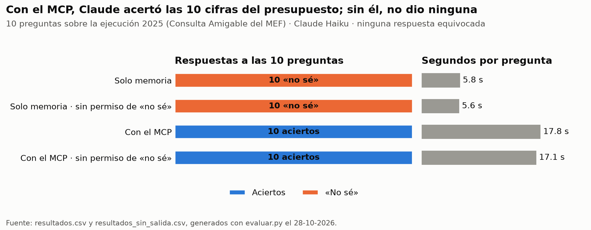

# Informe · ¿Ayuda un MCP de la Consulta Amigable a que Claude dé cifras correctas del presupuesto?

Le hice a Claude Haiku 10 preguntas sobre la ejecución del presupuesto 2025, primero sin herramientas («solo
memoria») y luego con mi servidor MCP de la Consulta Amigable del MEF. Cada respuesta se comparó con la cifra
oficial de la web del MEF. 2025 es un año cerrado, así que las cifras ya no cambian.

## Resultados

Corrida base (`uv run evaluar.py`, archivo `resultados.csv`):

| Modo | Aciertos | Errores | «No sé» | Segundos por pregunta |
|---|---|---|---|---|
| Solo memoria | 0 | 0 | 10 | 5.8 |
| Con el MCP | 10 | 0 | 0 | 17.8 |

Por pregunta (cifras en la unidad que pide cada pregunta: millones de soles, soles o %):

| Pregunta | Cifra oficial | Respuesta con el MCP | Con el MCP | Solo memoria |
|---|---|---|---|---|
| `pim_minedu_25` · PIM del Ministerio de Educación (millones) | 10,137.99 | 10,137.99 | acierta | no sabe |
| `avance_minedu_25` · avance del Ministerio de Educación (%) | 96.6 | 96.6 | acierta | no sabe |
| `dev_monterrico_25` · devengado del Pedagógico de Monterrico (soles) | 14,510,157 | 14,510,157 | acierta | no sabe |
| `pia_ves_25` · PIA de la Municipalidad de Villa El Salvador (soles) | 145,058,631 | 145,058,631 | acierta | no sabe |
| `avance_regionales_25` · avance de los gobiernos regionales (%) | 96.8 | 96.8 | acierta | no sabe |
| `dev_total_25` · devengado total del Estado (millones) | 253,674.60 | 253,674.60 | acierta | no sabe |
| `dev_bys_gn_25` · bienes y servicios del Gobierno Nacional (millones) | 23,978.69 | 23,978.69 | acierta | no sabe |
| `dev_minedu_dic25` · devengado de diciembre del Ministerio de Educación (millones) | 1,021.98 | 1,021.98 | acierta | no sabe |
| `avance_pronabec_2025` · avance de PRONABEC (%) — pregunta mía | 96.5 | 96.5 | acierta | no sabe |
| `avance_callao_25` · avance del Gobierno Regional del Callao (%) — pregunta mía | 91.5 | 91.5 | acierta | no sabe |

## Qué acertó y qué no, y por qué

- **Solo memoria: 0 aciertos y 10 «no sé».** En la columna `fuente`, Claude explica en todas que no tiene acceso a
  la Consulta Amigable y que no puede confirmar la cifra. La ejecución de 2025 no es algo que el modelo sepa de
  memoria, y la instrucción le permitía responder `null`.
- **Con el MCP: 10 de 10.** En la columna `fuente` cada respuesta nombra la entidad, el código que usó y la URL de
  la tabla del MEF, así que cada cifra se puede revisar. Usó unas 4 llamadas por pregunta (`turnos` = 4.3):
  primero `buscar_entidad` para encontrar el código y luego `resumen` o `consulta_amigable` para la cifra.
- **Es más lento:** 17.8 s por pregunta, contra 5.8 s sin herramientas, porque cada respuesta espera a la web del MEF.
- **La evaluación también encontró un error mío.** En la primera corrida el MCP sacó 9 de 10. Al revisar la pregunta
  que falló vi que el código de pliego 010 lo usan dos pliegos: el Ministerio de Educación (sector 10) y la
  Dirección Nacional de Inteligencia (sector 01, PCM, con un PIM de S/ 97 millones). Filtrar solo por el pliego
  sumaba los dos. Corregí las cifras oficiales de dos preguntas del Ministerio de Educación, hice que el servidor
  pida el sector cuando un código de pliego se repite y agregué una prueba para ese caso.

## Experimento extra: sin permiso para decir «no sé»

Quité de la instrucción la frase «Si no puedes saberlo con certeza, pon valor null: no estimes.» y volví a correr
(`uv run evaluar.py --sin-salida`, archivo `resultados_sin_salida.csv`):

| Modo | Aciertos | Errores | «No sé» | Segundos por pregunta |
|---|---|---|---|---|
| Solo memoria | 0 | 0 | 10 | 5.6 |
| Con el MCP | 10 | 0 | 0 | 17.1 |

Esperaba que, sin esa salida, Claude inventara cifras. No lo hizo: siguió respondiendo que no tenía acceso a los
datos en las 10 preguntas. Una explicación posible es que el formato de respuesta (`evaluar.py` le pide un JSON)
todavía acepta `null` como valor, así que quitar la frase no le quita del todo esa opción.

## Dos cifras comprobadas a mano en la web del MEF

Las dos son las preguntas que agregué. Las busqué en el navegador de la
[Consulta Amigable](https://apps5.mineco.gob.pe/transparencia/Navegador/default.aspx), año 2025, «Actividades y
Proyectos»:

1. **PRONABEC, avance 96.5 %.** Ruta: Gobierno Nacional › 10 Educación › 010 M. de Educación › Ejecutora 117-1438
   Programa Nacional de Becas y Crédito Educativo. PIM S/ 1,592,596,902 y devengado S/ 1,536,535,701.
   [Tabla en la web](https://apps5.mineco.gob.pe/transparencia/Navegador/Navegar_7.aspx?_uhc=yes&0=&4=1438&1=&y=2025&ap=ActProy)
2. **Gobierno Regional del Callao, avance 91.5 %.** Ruta: Gobiernos Regionales › 99 Gobiernos Regionales › 464
   Gobierno Regional de la Provincia Constitucional del Callao. PIM S/ 1,770,865,397 y devengado S/ 1,621,013,600.
   [Tabla en la web](https://apps5.mineco.gob.pe/transparencia/Navegador/Navegar_7.aspx?_uhc=yes&0=&2=99&3=464&1=&y=2025&ap=ActProy)

Las dos coinciden con lo que respondió el MCP.

## Conclusión

- Sin herramientas, Claude no conoce la ejecución del presupuesto 2025 y, al menos Haiku, prefirió no responder
  antes que inventar, incluso sin permiso explícito para decir «no sé».
- Con el MCP acertó las 10 cifras, y lo más valioso es que cada una trae la URL de la tabla del MEF: se puede auditar.
- Un MCP vale la pena cuando la fuente es una base que se consulta por códigos y niveles, como la Consulta Amigable,
  y se necesitan cifras exactas y repetibles. La búsqueda web basta cuando la cifra ya aparece escrita en una nota
  o un reporte publicado.
- No medí la búsqueda web. Como la Consulta Amigable se navega con clics en un formulario, es probable que la
  búsqueda web no llegue a la tabla, pero queda por comprobar con `uv run evaluar.py --modos memoria web mcp`.
