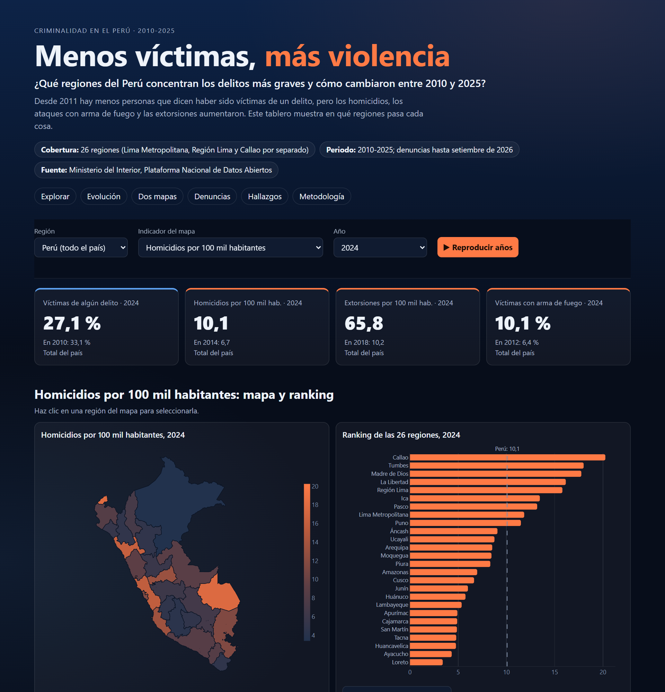
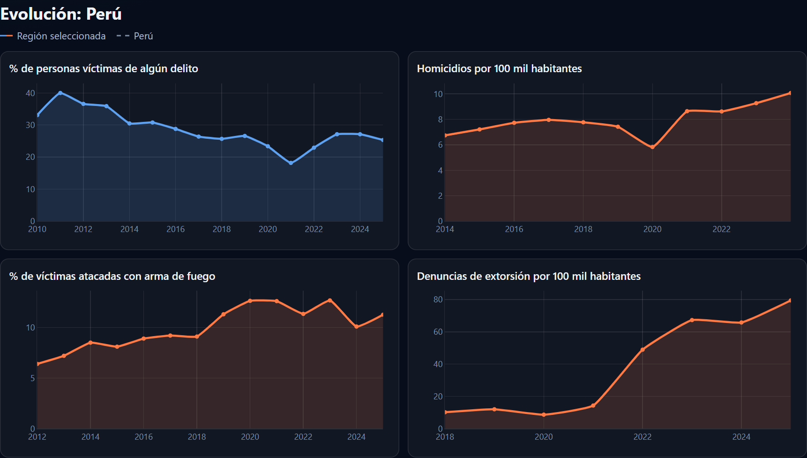
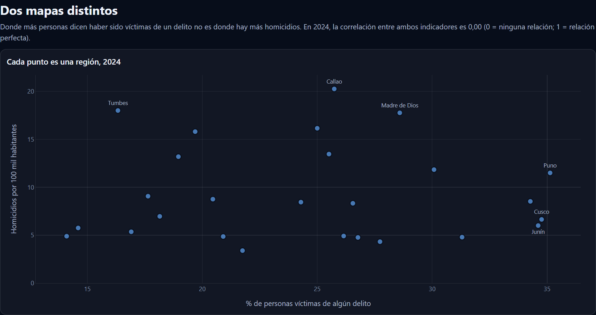

# Menos víctimas, más violencia

**Tarea 3 · Python Intermedio · Noelia Leon Ruiz**

**Pregunta de investigación:** ¿Qué regiones del Perú concentran los delitos más graves y cómo cambiaron entre 2010 y 2025?

| | |
|---|---|
| 📊 Dashboard | https://noelialruiz.github.io/Python_intermedio_2026/tarea_3/web/ |
| 🎬 Reel | [`reel/reel.mp4`](reel/reel.mp4) (66 s, vertical 1080 × 1920) |
| 💼 LinkedIn | https://www.linkedin.com/feed/update/urn:li:ugcPost:7522718489015476224/ |

## El proyecto

Desde 2011 hay menos personas que dicen haber sido víctimas de un delito, pero los homicidios, los ataques con arma de fuego y las extorsiones aumentaron. Con datos abiertos del Ministerio del Interior armé un dashboard interactivo de las 26 regiones del país (2010-2025) y un reel que cuenta los hallazgos con mi voz clonada con IA.

- **Cobertura:** 26 regiones (24 departamentos y el Callao; el departamento de Lima se divide en Lima Metropolitana y Región Lima, como en los datos del Mininter) y los 43 distritos de Lima Metropolitana.
- **Periodo:** 2010-2025; las denuncias policiales llegan hasta setiembre de 2026.



## Tres hallazgos

1. **Hay menos víctimas.** En 2011, el 40,0 % de las personas de 15 años a más dijo haber sido víctima de algún delito; en 2025, el 25,3 %. La victimización de 2025 es menor que la de 2010 en 24 de las 26 regiones.
2. **Pero el delito es más violento.** Los homicidios pasaron de 2076 en 2014 a 3426 en 2024 (de 6,7 a 10,1 por 100 mil habitantes) y subieron en 19 de las 26 regiones; en Lima Metropolitana, la tasa se multiplicó por 2,5. De cada 100 víctimas, 6 fueron atacadas con arma de fuego en 2012 y 11 en 2025. Las denuncias de extorsión pasaron de 3223 (2018) a 27 292 (2025): 8,5 veces más.
3. **La violencia grave está en otras regiones.** Callao, La Libertad, Región Lima y Tumbes están a la vez entre las 6 regiones con más homicidios (2024) y con más extorsiones (2025). En cambio, donde más personas dicen ser víctimas es en Arequipa, Puno y Cusco (2025). Entre regiones, la victimización y la tasa de homicidios no tienen relación (correlación 0,0 en 2024).



## Datos y metodología

**Fuentes** (Plataforma Nacional de Datos Abiertos, Ministerio del Interior; descargadas el 1 de noviembre de 2026):

- [Indicadores de seguridad ciudadana y tendencias territoriales](https://www.datosabiertos.gob.pe/dataset/indicadores-de-seguridad-ciudadana-y-tendencias-territoriales-mininter): por región y año, la victimización (encuesta ENAPRES del INEI), los homicidios (Comité Estadístico Interinstitucional de la Criminalidad, CEIC), las denuncias de extorsión y secuestro (SIDPOL) y los feminicidios, 2009 a agosto de 2026.
- [Denuncias policiales registradas a nivel nacional](https://www.datosabiertos.gob.pe/dataset/denuncias-policiales-registradas-nivel-nacional-mininter): denuncias del SIDPOL por mes, distrito y tipo, enero 2018 a setiembre 2026.
- Límites para los mapas: provincias del Perú de [juaneladio/peru-geojson](https://github.com/juaneladio/peru-geojson) (MPL-2.0) y distritos de Lima del IGN, de [joseluisq/peru-geojson-datasets](https://github.com/joseluisq/peru-geojson-datasets) (MIT).

El archivo [`datos/originales/fuentes.json`](datos/originales/fuentes.json) guarda el enlace y la fecha de descarga de cada archivo.

**Procesamiento:**

- Cada distrito se asignó a una región según su ubigeo: la provincia de Lima es Lima Metropolitana (1501) y el resto del departamento, Región Lima (1599).
- Se sumó una fila repetida de la base de denuncias y se unificaron los nombres de los tipos de denuncia.
- 2026 quedó solo en la serie mensual, porque el año está incompleto.
- Las tasas son casos por cada 100 mil habitantes, con la población proyectada que publica el Mininter para cada región y año.
- Como revisión cruzada, las denuncias de extorsión de las dos bases del Mininter difieren entre 1,6 % y 5,3 % por año.
- El mapa de distritos del IGN no trae ubigeo: se unió por el nombre del distrito, y los 43 coinciden.

**Dashboard:** página estática en GitHub Pages hecha con HTML, CSS y [Plotly.js](https://plotly.com/javascript/). Tiene:

- **Indicadores:** 4 (víctimas de algún delito, homicidios, extorsiones y víctimas con arma de fuego).
- **Visualizaciones:** mapa y ranking de las regiones, evolución de los 4 indicadores, dispersión entre victimización y homicidios, denuncias por mes y mapa de los distritos de Lima.
- **Filtros:** región, indicador, año, tipo de denuncia y año del mapa de Lima.
- **Extras:** un botón que recorre los años, clic en el mapa para elegir región, descarga en CSV y vista en tabla.



## Limitaciones

- Una denuncia no es un delito: muchas víctimas no denuncian, y eso cambia entre regiones y en el tiempo.
- Desde noviembre de 2024 faltan las denuncias virtuales de robo y hurto (el canal estuvo fuera de servicio), así que la caída de esas denuncias en 2025 no significa necesariamente que haya menos robos.
- La victimización viene de una encuesta urbana con margen de error; las diferencias pequeñas entre regiones o años pueden no ser reales.
- Los homicidios por región llegan hasta 2024, y los feminicidios se muestran como número de casos, no como tasa.
- Los límites de los mapas son referenciales. Que dos indicadores se muevan juntos no prueba que uno cause el otro.

## Cómo reproducirlo (Windows, Python 3.12, [uv](https://docs.astral.sh/uv/))

**1. Datos y análisis**

```powershell
cd tarea_3
uv venv --python 3.12
.venv\Scripts\activate
uv pip install -r requirements.txt
python scripts/obtener_datos.py      # descarga los datos (si ya están, no los vuelve a bajar)
python scripts/procesar_datos.py     # limpia, une y arma web/data
python scripts/analizar_datos.py     # calcula los hallazgos (datos/procesados/hallazgos.json)
```

**2. Dashboard en tu computadora**

```powershell
cd web
python -m http.server 8000           # y abrir http://localhost:8000
```

**3. Reel**, en un entorno aparte con [`reel/requirements.txt`](reel/requirements.txt). Hace falta Microsoft Edge para las capturas y una grabación propia de 15 a 25 segundos.

```powershell
python reel/recursos.py              # fondo, gráficos grandes, captura del dashboard y música
python reel/hacer_reel.py --voz reel/mi_voz.m4a --autor "Tu nombre" --texto-voz "lo que dices en la grabación"
```

Mi grabación (`reel/mi_voz.*`) no está en el repositorio: con ella cualquiera podría clonar mi voz.

## Estructura

```text
tarea_3/
├── README.md
├── requirements.txt          # datos y análisis
├── scripts/                  # obtener, procesar y analizar los datos
├── datos/originales/         # archivos tal como se descargaron + fuentes.json
├── datos/procesados/         # tablas limpias y hallazgos.json
├── web/                      # dashboard (index.html, assets/, data/)
├── reel/                     # guion.json, recursos.py, graficos.html, hacer_reel.py, reel.mp4, subtitulos.srt
└── capturas/                 # imágenes del dashboard para el README y LinkedIn
```

## Reel: créditos

- **Voz:** generada con IA ([Qwen3-TTS 0.6B](https://huggingface.co/Qwen/Qwen3-TTS-12Hz-0.6B-Base)) a partir de mi propia voz, con una ecualización suave para que suene menos nasal.
- **Subtítulos:** sincronizados con faster-whisper ([`reel/subtitulos.srt`](reel/subtitulos.srt)).
- **Música:** «Lightless Dawn», Kevin MacLeod (incompetech.com), licencia [CC BY 4.0](https://creativecommons.org/licenses/by/4.0/).
- **Tipografía:** Barlow Condensed (SIL Open Font License).
- **Datos:** Ministerio del Interior.
- **Guion:** cada cifra lleva su origen en el campo `dato` de [`reel/guion.json`](reel/guion.json).

## Uso de inteligencia artificial

- Usé **Claude Code (Anthropic)** para comparar fuentes, escribir y probar el código (scripts, dashboard y reel).
- Usé **Qwen3-TTS** para clonar mi voz y **Whisper** para los subtítulos.
- Revisé cada cifra contra las fuentes oficiales y elegí el enfoque, los textos y el diseño finales.

